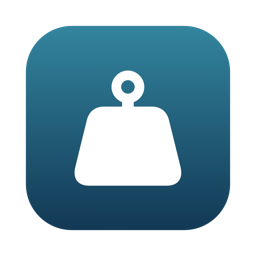
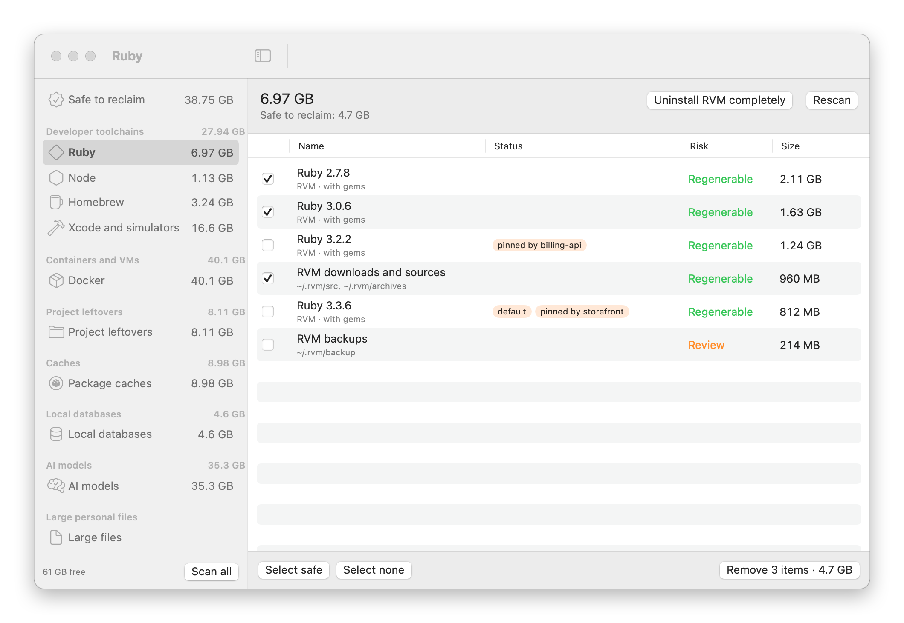
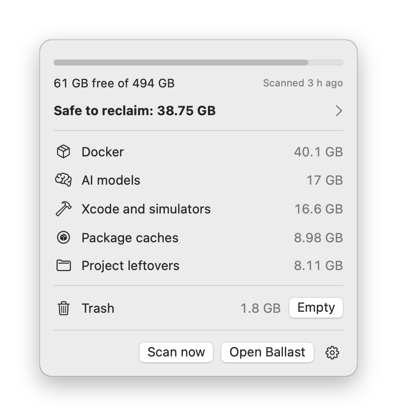
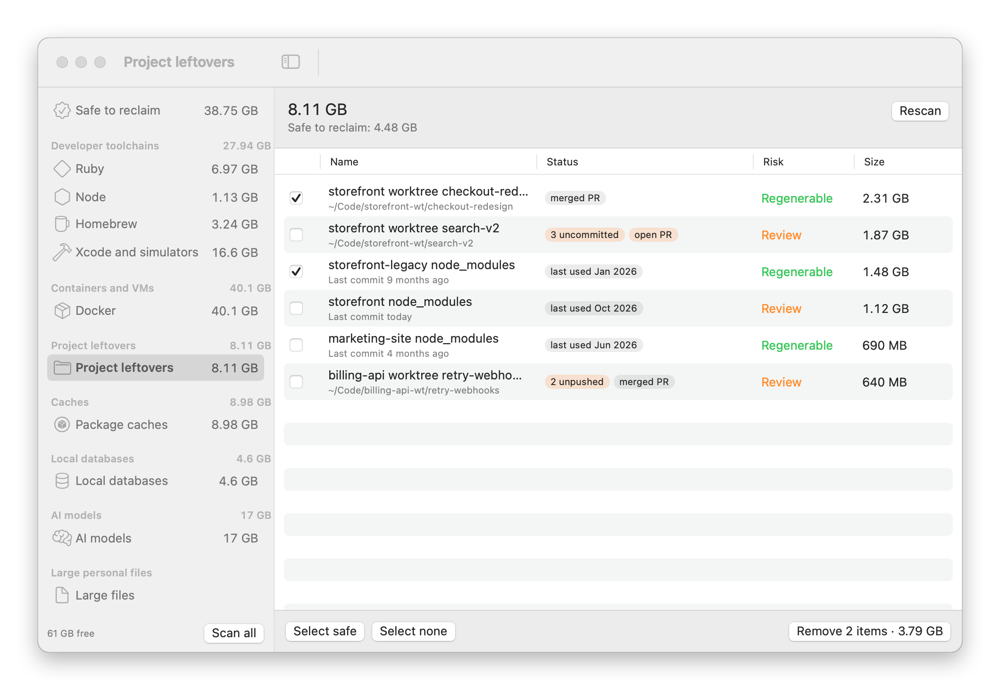
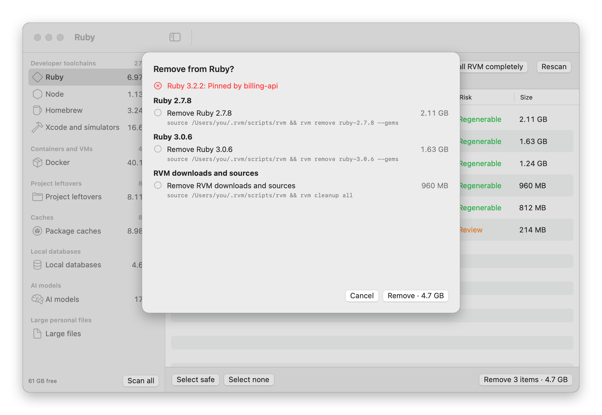
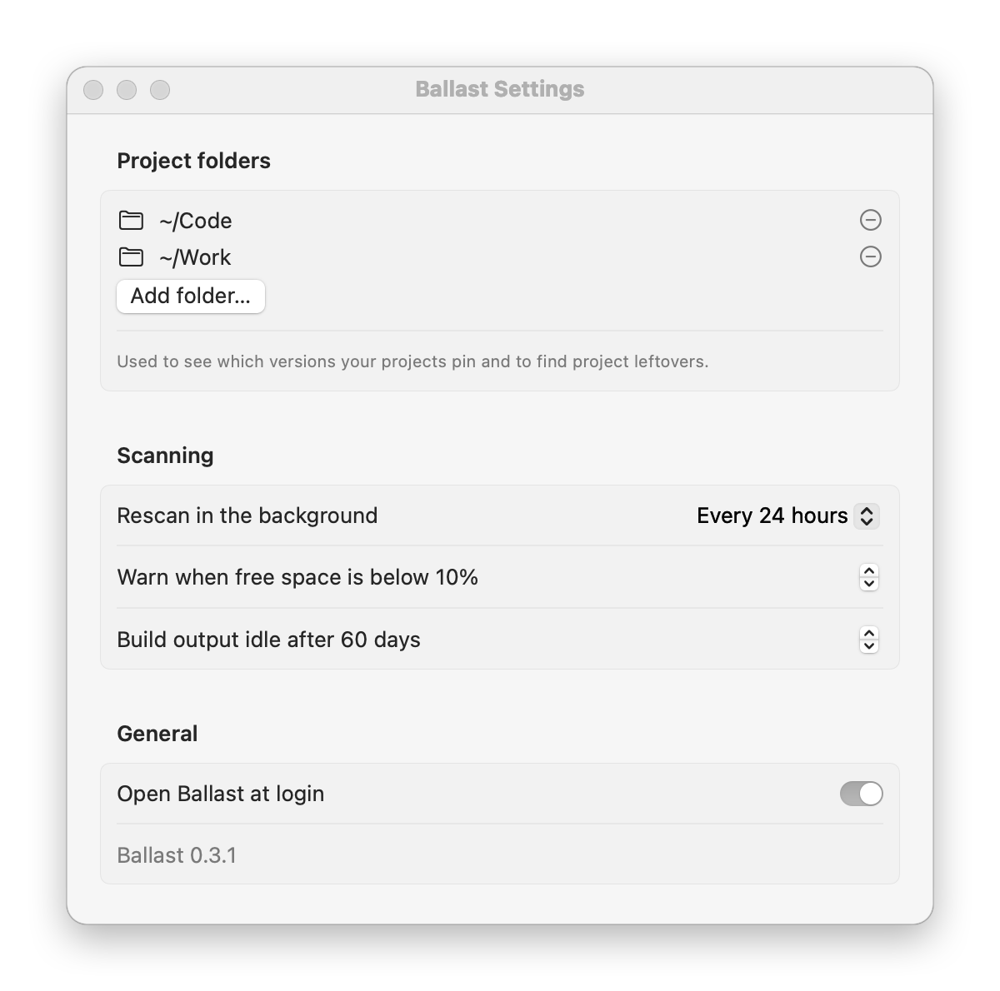

<p align="center">
  
</p>

<h1 align="center">Ballast</h1>

<p align="center">A menu bar app for macOS that finds the disk space developer tools leave behind, and gives it back safely.</p>

<picture>
  <source media="(prefers-color-scheme: dark)" srcset="docs/screenshots/main-dark.png">
  
</picture>

Ballast looks at the things that quietly fill a developer's disk and shows what each one is, how big it is, and whether anything still uses it:

- **Developer toolchains:** Ruby, Node and Python versions (rvm, rbenv, asdf, nvm, fnm, pyenv), Homebrew leftovers, Xcode versions, simulators and runtimes, GitHub Actions runners
- **Containers and VMs:** Docker images, volumes and build cache, and Docker Desktop itself
- **Project leftovers:** `node_modules` in projects you haven't touched for a while, and git worktrees whose pull request is merged
- **Caches:** package manager caches (npm, Yarn, pnpm, pip, Cargo, Gradle, CocoaPods and more) and large app caches
- **Local databases:** Postgres, MySQL, Redis and others installed with Homebrew
- **AI models:** Ollama, Hugging Face, Whisper and LM Studio models
- **Apps:** your apps with their size and when you last opened them, removed together with their leftovers
- **Large personal files:** the biggest files in your home folder, only when you ask

The menu bar icon shows free space at a glance. Click it for a summary, or open the main window to review and remove things.

<p align="center">
<picture>
  <source media="(prefers-color-scheme: dark)" srcset="docs/screenshots/menu-dark.png">
  
</picture>
</p>

Project leftovers shows which `node_modules` folders belong to projects you haven't touched in a while, and which git worktrees are done with: their pull request is merged and nothing is left uncommitted or unpushed.

<picture>
  <source media="(prefers-color-scheme: dark)" srcset="docs/screenshots/projects-dark.png">
  
</picture>

## Safety

Ballast is built so that cleaning up is hard to regret.

<picture>
  <source media="(prefers-color-scheme: dark)" srcset="docs/screenshots/confirm-dark.png">
  
</picture>

- **Nothing happens without a preview.** You tick items, then see every step Ballast will take (each path it will move and each command it will run) before you confirm.
- **It checks again before acting.** Just before running, Ballast re-checks each item. If something changed since the scan (a version is now pinned by a project, a worktree has new changes, a database is running), that step is skipped and the reason is shown.
- **Files go to the Trash,** not straight to deletion, so you can put them back.
- **Tools clean up their own data.** Where a tool has its own way to remove something (`brew uninstall`, `docker image rm`, `ollama rm`, `git worktree remove`, `xcrun simctl delete`), Ballast uses it, so the tool's own records stay correct.
- **Some things are refused outright:** a Ruby or Node version one of your projects pins, a worktree with uncommitted changes, an app that ships with macOS. The reason is shown next to the item.
- **Each item has a risk level.** *Regenerable* means it can be rebuilt or re-downloaded, *Review* means you should look first, and *Your data* means only you can say whether it's needed. **Select safe** ticks only the regenerable ones.
- Every action is logged to `~/Library/Application Support/Ballast/actions.log`.

## Permissions

Ballast asks for nothing up front. It reads your home folder like any app you run. If a step needs more, it says so when you reach that step:

- **Full Disk Access** is only needed for protected locations (some app containers and the Docker disk image). Ballast shows those items as locked and explains how to grant access if you want them measured.
- **Administrator steps,** such as removing Docker's system helpers, are never run for you. Ballast shows the exact `sudo` command for you to run in Terminal.
- **Finder** is used to empty the Trash, so macOS may ask once whether Ballast can control Finder.

## Install

### From source

You need macOS 14 or later and Swift 6. The Command Line Tools are enough (`xcode-select --install`); you don't need Xcode.

```sh
git clone https://github.com/linearza/ballast.git
cd ballast
make install
```

This builds Ballast, copies it to `~/Applications` and opens it.

If the build stops at `Invalid manifest` with `Undefined symbols … PackageDescription.Package`, your Swift compiler and its package library come from different versions of the Command Line Tools, usually after a macOS update. Reinstall them and build again:

```sh
sudo rm -rf /Library/Developer/CommandLineTools
xcode-select --install
```

If you have Xcode, `sudo xcode-select -s /Applications/Xcode.app` works too. Or skip building and install [from a release](#from-a-release).

### From a release

Download `Ballast-x.y.z.zip` from [Releases](https://github.com/linearza/ballast/releases), unzip it, and move `Ballast.app` to `~/Applications` or `/Applications`.

Ballast is not notarised, so macOS blocks it the first time. Either open **System Settings → Privacy & Security** and click **Open Anyway**, or run:

```sh
xattr -dr com.apple.quarantine ~/Applications/Ballast.app
```

Ballast checks GitHub once a day for a newer release and shows a link in the menu when there is one. It never updates itself.

## First run

Ballast asks where your projects live. It uses those folders to see which language versions your projects need (from files like `.ruby-version`, `.nvmrc`, `.tool-versions` and `package.json`), so it never suggests removing one that's in use, and to find project leftovers. You can change the folders in Settings at any time.

## Settings

<p align="center">
<picture>
  <source media="(prefers-color-scheme: dark)" srcset="docs/screenshots/settings-dark.png">
  
</picture>
</p>

- Project folders
- How often to rescan in the background: off, every 6 hours or every 24 hours
- When to warn about low free space (10% by default)
- How long a project must be idle before its `node_modules` counts as safe (60 days by default)
- Open at login

## Uninstall

```sh
make uninstall
```

This quits Ballast, moves the app to the Trash and removes `~/Library/Application Support/Ballast`. Or drag `Ballast.app` to the Trash yourself.

## Development

```sh
make test      # run the tests
make app       # build dist/Ballast.app
make icon      # re-render Resources/AppIcon.icns
make release   # universal build and dist/Ballast-<version>.zip
make screenshots  # re-render docs/screenshots from sample data
```

The screenshots use made-up projects and sizes, not anything from the machine that renders them.

The scanning and cleanup logic lives in `Sources/BallastCore` and is tested against fixture folders and a fake command runner. `Sources/Ballast` is the SwiftUI and AppKit app.

## Licence

MIT
