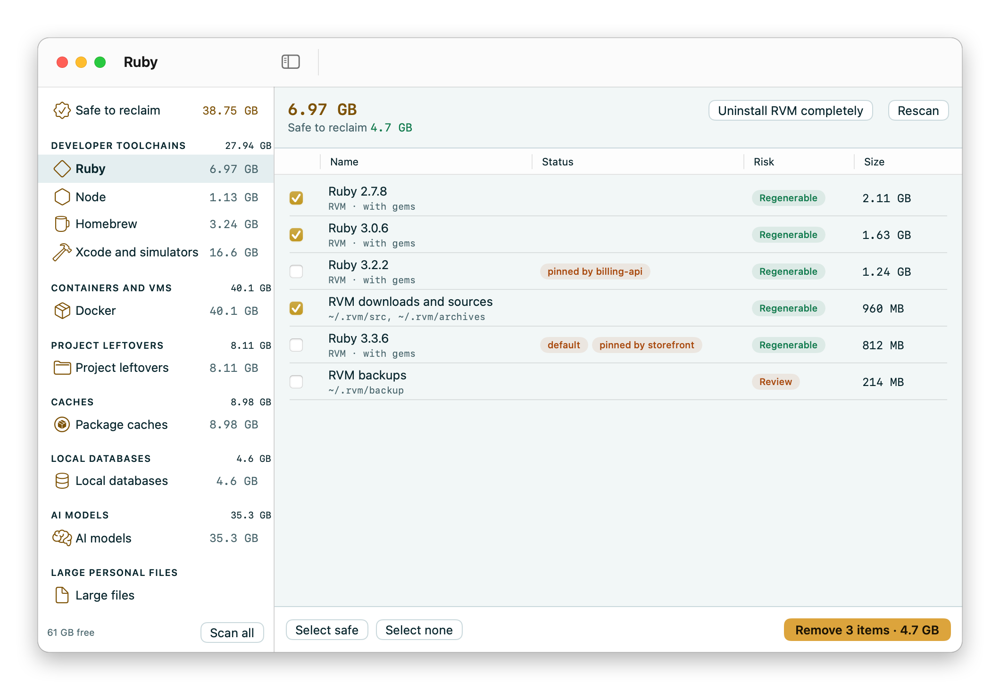
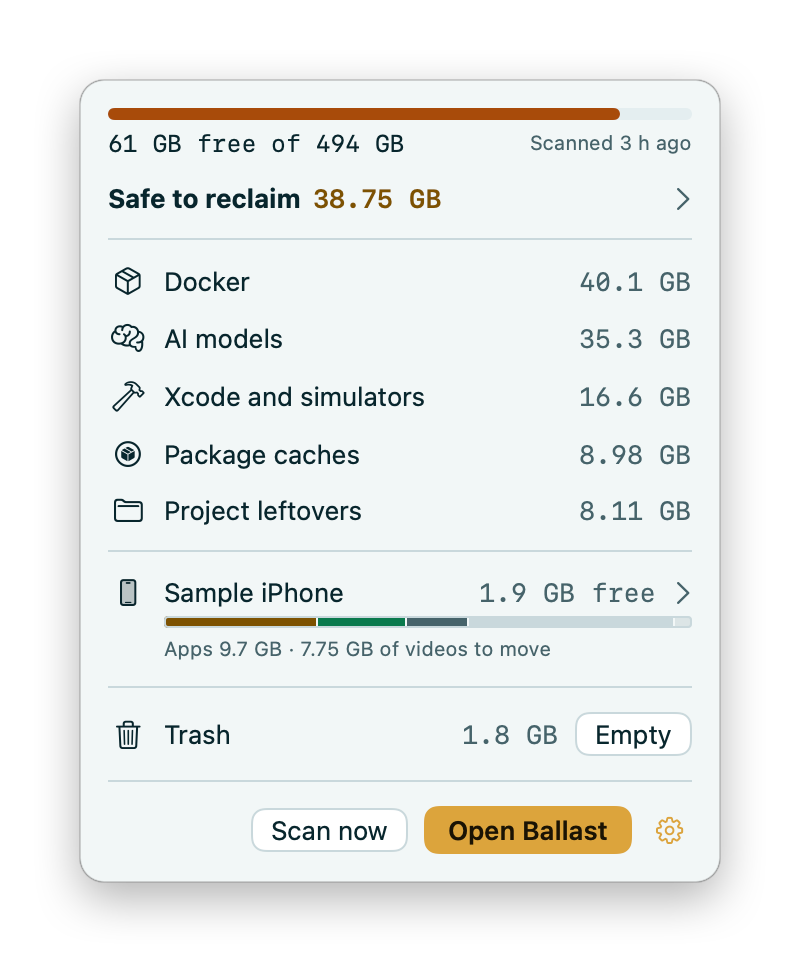
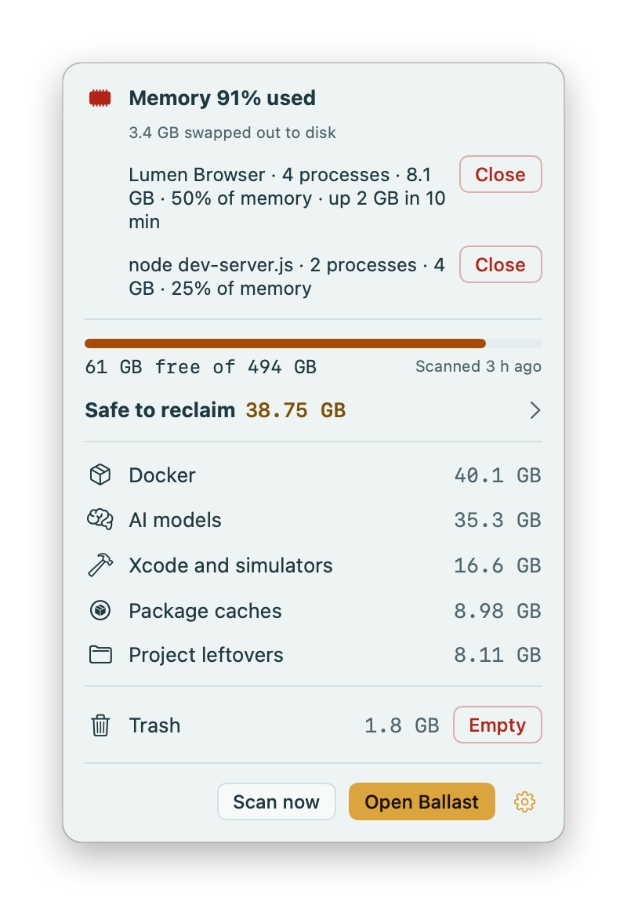
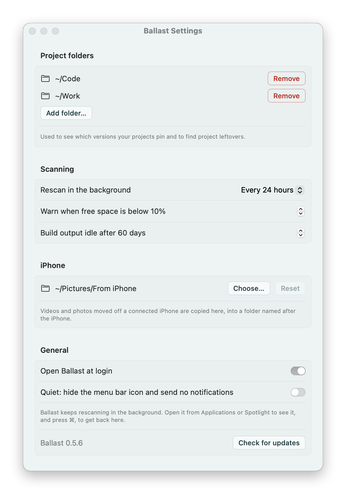
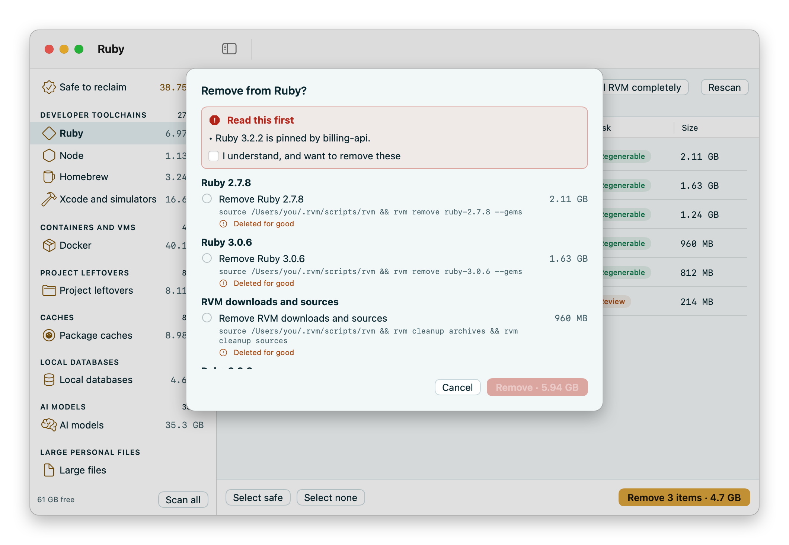

<p align="center">
  
</p>

<h1 align="center">Ballast</h1>

<p align="center">Get your disk space back from your developer tools, without breaking a project.</p>

<p align="center">
  <a href="https://ballast.linear.co.za">Website</a> ·
  <a href="https://github.com/linearza/ballast/releases/latest">Download</a> ·
  <a href="CHANGELOG.md">Changelog</a>
</p>

<picture>
  <source media="(prefers-color-scheme: dark)" srcset="docs/screenshots/main-dark.png">
  
</picture>

Ballast is a free, open-source menu bar app for macOS. It finds old Ruby and Node versions, idle `node_modules`, simulator runtimes, Docker images, package caches, AI models and iPhone videos, and removes the ones nothing uses.

## Features

- Memory alerts that name what's using your RAM, with a Close button
- Knows which versions your projects pin, which worktrees have unpushed work and which databases are running
- Lists every path and command before anything runs
- Labels every item *Regenerable*, *Review* or *Your data*
- Covers 60+ tools, from rvm to Ollama
- Moves iPhone videos to your Mac over USB
- No account, no analytics, no permissions up front

<details>
<summary>Everything it finds</summary>

| | |
|---|---|
| **Developer toolchains** | Ruby, Node and Python versions (rvm, rbenv, chruby, frum, asdf, mise, nvm, fnm, n, nodenv, pyenv, uv), conda environments, pipx apps and Poetry, Pipenv and Hatch virtualenvs; Java, Go, Rust, Elixir, PHP and other languages (SDKMAN, goenv, rustup, asdf, mise); Homebrew leftovers and runaway service logs, GitHub Actions runners |
| **Xcode and Android** | Xcode versions, simulators, runtimes, device support for iOS, watchOS, tvOS and visionOS, simulator logs and docs; Android system images, NDKs and emulators |
| **Containers and VMs** | Docker images, volumes and build cache, Docker Desktop itself, Colima, Lima, minikube, Podman and Rancher Desktop machines, Parallels and VMware virtual machines |
| **Project leftovers** | Build output in projects you haven't touched for a while (`node_modules`, `target`, `.venv`, `.next`, `Pods`, `.gradle`, `_build` and more), and git worktrees whose pull request is merged |
| **Caches** | Package manager caches (npm, Yarn, pnpm, Bun, Deno, pip, uv, Poetry, conda, Cargo, Go modules, Gradle, Maven, sbt, CocoaPods, Carthage, SwiftPM, NuGet, Composer and more) and large app caches |
| **Local databases** | Postgres, MySQL, Redis and others from Homebrew, Postgres.app and DBngin |
| **AI models** | Ollama, Hugging Face, Whisper, LM Studio, GPT4All, Jan, llama.cpp, DiffusionBee and PyTorch Hub models |
| **AI tools and editors** | Caches and old workspace data of Cursor, VS Code, Windsurf and the Claude app, old Claude Code versions, and Claude Code history for projects that no longer exist |
| **Apps** | Your apps with their size and when you last opened them, removed with their leftovers and background helpers |
| **Connected iPhone** | Storage use over USB, the biggest videos and photos, and apps |
| **Large personal files** | The biggest files in your home folder, only when you ask, with files in iCloud Drive marked |

</details>

## Install

Requires macOS 14 or later.

### Download

Download `Ballast-x.y.z.zip` from [Releases](https://github.com/linearza/ballast/releases/latest), unzip it, and move `Ballast.app` to `~/Applications` or `/Applications`.

Ballast isn't notarised, so macOS blocks the first launch. Click **Open Anyway** in **System Settings → Privacy & Security**, or run:

```sh
xattr -dr com.apple.quarantine ~/Applications/Ballast.app
```

### Build from source

Needs Swift 6. The Command Line Tools are enough (`xcode-select --install`).

```sh
git clone https://github.com/linearza/ballast.git
cd ballast
make install
```

This builds Ballast, copies it to `~/Applications` and opens it. The bundled iPhone tools are built too, which takes a few minutes the first time and needs `brew install cmake pkg-config`. Without them the app still builds and uses the tools on your PATH. `make release` always builds them.

<details>
<summary>Build fails with <code>Invalid manifest</code></summary>

If you see `Undefined symbols … PackageDescription.Package`, your Swift compiler and package library come from different Command Line Tools versions, usually after a macOS update. Reinstall them:

```sh
sudo rm -rf /Library/Developer/CommandLineTools
xcode-select --install
```

With Xcode installed, `sudo xcode-select -s /Applications/Xcode.app` works too.

</details>

### Updates

Ballast checks GitHub once a day and shows *Update to x.y.z* in the menu and Settings when a release is out. One click downloads it, verifies it and relaunches.

<details>
<summary>How updates are checked</summary>

The zip comes only from `github.com` and GitHub's release-asset hosts, over https. Before swapping it in, Ballast checks that it is Ballast, is the version offered, is newer than the running one, and passes `codesign --verify`. Any failed check leaves your copy untouched. The old copy goes to the Trash. It won't update during a clean-up, never asks for your password (if its folder isn't writable, it tells you to download the release yourself), and logs updates in `actions.log`. *Check for updates* is in Settings and the gear menu. Quiet mode silences the notification.

</details>

## Usage

1. On first run, pick the folders where your projects live. Ballast reads `.ruby-version`, `.nvmrc`, `.tool-versions`, `mise.toml` and `package.json` there to see which versions are in use. Change them in Settings any time.
2. The menu bar icon shows free space. Click it for what's safe to reclaim, the biggest concerns, a connected iPhone and the Trash.
3. Open the window, tick what you want gone, review the steps and confirm.

Only one copy runs at a time. Opening it again brings up the existing window.

<p align="center">
<picture>
  <source media="(prefers-color-scheme: dark)" srcset="docs/screenshots/menu-dark.png">
  
</picture>
</p>

### Memory alerts

When memory runs short, the icon becomes a memory chip with the percentage in use. The menu lists the apps or process groups using the most, with size, share and recent growth, each with a **Close** button. Command-line tools are grouped per project folder, like `vitest · my-app`.

<p align="center">
<picture>
  <source media="(prefers-color-scheme: dark)" srcset="docs/screenshots/menu-memory-dark.png">
  
</picture>
</p>

There's no notification or sound. Close asks first and nothing closes automatically. An app gets **Force Quit** as a separate question if it's still running after 5 seconds; a process group gets **Force Stop** after 3. Close is offered only for your own apps and processes, never for macOS's, other users', root's or Ballast itself.

Ballast can't measure macOS's or other users' processes, and says so when nothing it can measure stands out. It reads overall memory every 30 seconds and on macOS memory-pressure events, and looks at individual apps only when memory is getting full or the menu is open. It uses about 28 MB and next to no CPU. Nothing about memory is saved or sent. Quiet mode stops the checks.

### Settings

<details>
<summary>All settings</summary>

<p align="center">
<picture>
  <source media="(prefers-color-scheme: dark)" srcset="docs/screenshots/settings-dark.png">
  
</picture>
</p>

- Project folders
- Background rescans: off, every 6 hours or every 24 hours
- Low free space warning: 10% by default
- Idle time before build output (`node_modules`, `target`, `.venv`) counts as safe: 60 days by default
- Where iPhone videos and photos go: `~/Pictures/From iPhone` by default
- Open at login
- Quiet mode hides the menu bar icon and stops notifications; background rescans carry on. **Go Quiet…** in the gear menu turns it on too. While quiet, open Ballast from Applications or Spotlight, and press ⌘, for Settings.

</details>

## Safety

Every removal shows each path it will move and each command it will run before you confirm. Ballast checks each item again just before it runs, and skips anything that changed since the scan.

<picture>
  <source media="(prefers-color-scheme: dark)" srcset="docs/screenshots/confirm-dark.png">
  
</picture>

- *Regenerable* items rebuild or re-download. *Review* items need a look. *Your data* is your call. **Select safe** ticks only Regenerable items.
- Files go to the Trash. Tool commands (`brew uninstall`, `docker image rm`) delete for good, and the step says so.
- Routine removals confirm with Return, Review items with a click. Anything that can lose work sits under **Read this first** and needs **I understand**.
- Every action is logged to `~/Library/Application Support/Ballast/actions.log`.

<details>
<summary>Safety in detail</summary>

- Your home folder and its Documents, Desktop, Downloads and Library, SSH and GPG keys, Keychains and macOS's own folders are never removed.
- Worktrees with uncommitted changes, running databases and VMs, editor settings databases and apps that ship with macOS are refused.
- Pinned versions are never ticked by Select safe. Removing one names the project and needs I understand, as do default versions, Docker volumes, app data and database files.
- Worktrees count as done only when the PR is merged and nothing is uncommitted or unpushed.
- Committed build folders (a checked-in `Pods` or `dist`) are source and aren't offered. Build folders under 1 MB aren't listed.
- iCloud Drive files are marked *in iCloud* and need I understand, since the Trash on one Mac removes them everywhere.
- Removing a Python version lists the pipx apps and Poetry, Pipenv or Hatch environments built on it. Uninstalling RVM names Rubies in use.
- App helpers in `~/Library/LaunchAgents` are stopped before the app goes to the Trash.
- Where a tool has its own removal command (`brew uninstall`, `docker image rm`, `ollama rm`, `git worktree remove`, `xcrun simctl delete`), Ballast uses it. An Ollama blob two models share stays until neither needs it.
- iPhone videos are copied to your Mac and size-checked before the original is deleted. On a mismatch the original stays and the bad copy is removed.
- With iCloud Photos on, deleting from the iPhone deletes from iCloud and your other devices. The Mac copies stay.
- Uninstalling an iPhone app deletes its data. It comes back on reinstall only if the app syncs it.
- Over USB, iPhone app sizes include caches iOS clears itself, and Messages, shared app data and System Data show as *Not visible over USB*.

</details>

## Permissions

Nothing up front. Ballast reads your home folder like any app you run.

- **Full Disk Access** is only for a few protected locations (some app containers, the Docker disk image). They show as locked, with steps to grant access.
- **Administrator steps** are never run for you. You get the exact `sudo` command.
- **Finder** empties the Trash and reads its size. macOS asks the first time you click Empty; if you said no, Ballast opens **Privacy & Security → Automation**.
- **iPhone** access uses libimobiledevice, built in. The phone must be unlocked and trusted. Photos and videos go through Image Capture, which macOS may ask about.
- **Memory alerts** read the size, name and working folder of your own processes. Nothing is saved.
- **Network:** a daily GitHub release check (plus the download when you update), and, if the GitHub CLI (`gh`) is signed in, whether a worktree's PR is merged.

## Uninstall

```sh
make uninstall
```

Quits Ballast, moves it to the Trash and removes `~/Library/Application Support/Ballast`. Or drag `Ballast.app` to the Trash.

## Development

```sh
make test         # run the tests
make app          # build dist/Ballast.app
make icon         # re-render Resources/AppIcon.icns
make release      # universal build and dist/Ballast-<version>.zip
make screenshots  # re-render docs/screenshots from sample data
```

Scanning and cleanup live in `Sources/BallastCore`, tested against fixture folders and a fake command runner. `Sources/Ballast` is the SwiftUI and AppKit app. Screenshots use made-up projects and sizes.

## Licence

MIT

### Official builds

The only official Ballast is on this repository's [Releases](https://github.com/linearza/ballast/releases) page, built and published by its maintainer. You're free to build, change and share your own copy. If you distribute a modified build, give it a different name, icon and bundle identifier (not `za.co.linear.ballast`), so nobody mistakes it for Ballast or has it replaced by a Ballast update.

### Third-party software

The release carries four command-line tools in `Ballast.app/Contents/Helpers` (`idevice_id`, `ideviceinfo`, `ideviceinstaller`, `afcclient`) to talk to an iPhone. They are built unmodified from the upstream libimobiledevice projects (libimobiledevice, libplist, libusbmuxd, libimobiledevice-glue, libtatsu and ideviceinstaller, under LGPL-2.1 or GPL-2), with libzip (BSD-3-Clause) and OpenSSL (Apache-2.0). The libraries are separate dylibs in `Ballast.app/Contents/Frameworks`, loaded at run time rather than linked in, so you can swap in your own build of any of them. Ballast runs the tools as separate programs and talks to them only through their command lines. Licence texts and a written offer of the source are in `Ballast.app/Contents/Resources/ThirdPartyNotices.txt`, and `scripts/vendor-imobiledevice.sh` builds them from the exact upstream tarballs, pinned by checksum.
