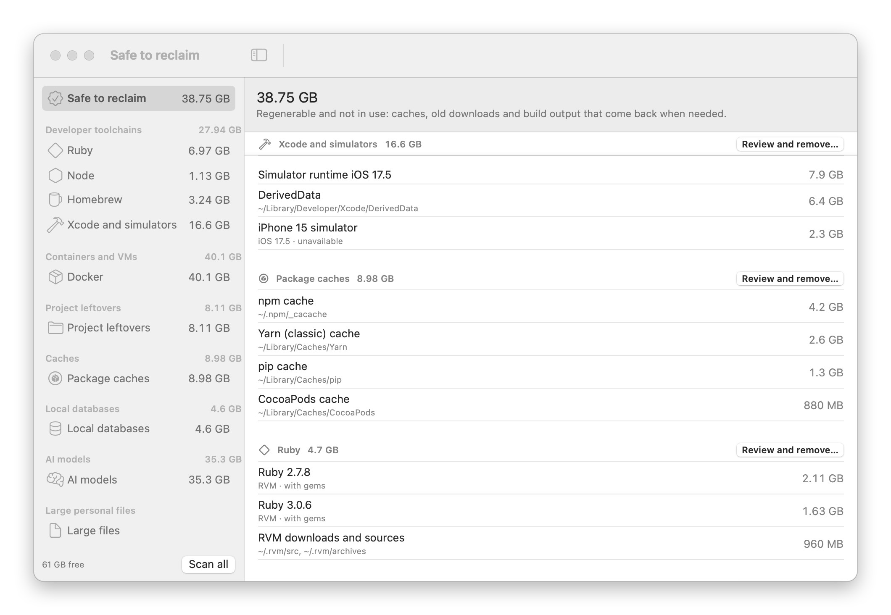
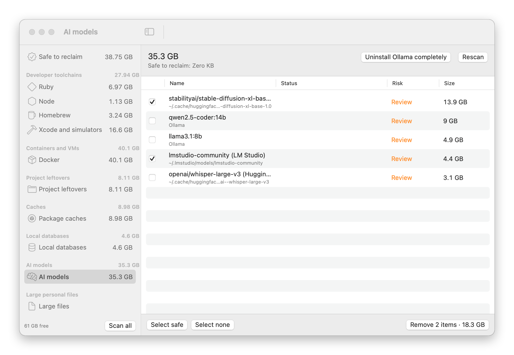

<p align="center">
  
</p>

<h1 align="center">Ballast</h1>

<p align="center">A menu bar app for macOS that finds the disk space developer tools leave behind, and gives it back safely.</p>

<picture>
  <source media="(prefers-color-scheme: dark)" srcset="docs/screenshots/main-dark.png">
  
</picture>

Old Ruby and Node versions, `node_modules` in projects you forgot about, simulator runtimes, Docker images, package caches, AI models you tried once. Developer tools leave tens of gigabytes behind, and most clean-up apps either can't see them or can't tell what's still in use. Ballast knows which version your projects pin, which worktree still has unpushed work and which database is running, and it shows you exactly what it will do before it does anything.

- **Sees developer clutter** that general cleaners miss, across more than 60 tools.
- **Knows what's in use:** versions your projects pin or you use by default, running databases, worktrees with open pull requests.
- **Previews every step**, says whether each one can be undone, and asks harder the more there is to lose.
- **Asks for no permissions up front,** needs no account and has no analytics.

## What it finds

| | |
|---|---|
| **Developer toolchains** | Ruby, Node and Python versions (rvm, rbenv, chruby, frum, asdf, mise, nvm, fnm, n, nodenv, pyenv, uv), conda environments, pipx apps and Poetry, Pipenv and Hatch virtualenvs; Java, Go, Rust, Elixir, PHP and other languages (SDKMAN, goenv, rustup, asdf, mise); Homebrew leftovers and runaway service logs, GitHub Actions runners |
| **Xcode and Android** | Xcode versions, simulators, runtimes, device support for iOS, watchOS, tvOS and visionOS, simulator logs and docs; Android system images, NDKs and emulators |
| **Containers and VMs** | Docker images, volumes and build cache, Docker Desktop itself, Colima, Lima, minikube, Podman and Rancher Desktop machines, Parallels and VMware virtual machines |
| **Project leftovers** | Build output in projects you haven't touched for a while (`node_modules`, `target`, `.venv`, `.next`, `Pods`, `.gradle`, `_build` and more), and git worktrees whose pull request is merged |
| **Caches** | Package manager caches (npm, Yarn, pnpm, Bun, Deno, pip, uv, Poetry, conda, Cargo, Go modules, Gradle, Maven, sbt, CocoaPods, Carthage, SwiftPM, NuGet, Composer and more) and large app caches |
| **Local databases** | Postgres, MySQL, Redis and others from Homebrew, Postgres.app and DBngin |
| **AI models** | Ollama, Hugging Face, Whisper, LM Studio, GPT4All, Jan, llama.cpp, DiffusionBee and PyTorch Hub models |
| **AI tools and editors** | Caches and old workspace data of Cursor, VS Code, Windsurf and the Claude app, old Claude Code versions, and Claude Code history for projects that no longer exist |
| **Apps** | Your apps with their size and when you last opened them, removed together with their leftovers and background helpers |
| **Large personal files** | The biggest files in your home folder, only when you ask, with files in iCloud Drive marked |

## A quick tour

The menu bar icon shows free space at a glance. Click it for a summary of the biggest concerns and what's safe to reclaim, or open the main window to review and remove things.

<p align="center">
<picture>
  <source media="(prefers-color-scheme: dark)" srcset="docs/screenshots/menu-dark.png">
  
</picture>
</p>

**Safe to reclaim** gathers everything Ballast is sure you can remove: caches, old downloads and build output that come back when needed, and nothing you use. Review and remove a group at a time.

<picture>
  <source media="(prefers-color-scheme: dark)" srcset="docs/screenshots/safe-dark.png">
  
</picture>

**Project leftovers** shows which `node_modules` and other build folders belong to projects you haven't touched in a while, and which git worktrees are done with: their pull request is merged and nothing is left uncommitted or unpushed.

<picture>
  <source media="(prefers-color-scheme: dark)" srcset="docs/screenshots/projects-dark.png">
  
</picture>

**AI models** lists every model you've downloaded, wherever the tool put it. Ollama models are removed with `ollama rm`, and a blob two models share stays until neither needs it.

<picture>
  <source media="(prefers-color-scheme: dark)" srcset="docs/screenshots/models-dark.png">
  
</picture>

## Safety

Ballast is built so that cleaning up is hard to regret.

<picture>
  <source media="(prefers-color-scheme: dark)" srcset="docs/screenshots/confirm-dark.png">
  
</picture>

- **Nothing happens without a preview.** You tick items, then see every step Ballast will take (each path it will move and each command it will run) before you confirm.
- **It checks again before acting.** Just before running, Ballast re-checks each item. If something changed since the scan (a version is now pinned by a project, a worktree has new changes, a database is running), that step is skipped and the reason is shown.
- **Each step says whether it can be undone.** Files go to the Trash, so you can put them back. Commands a tool runs for itself (`brew uninstall`, `docker image rm` and the like) delete for good, and the step says so.
- **The more it matters, the more Ballast asks.** Routine clean-ups confirm with Return. Anything that needs a look (a *Review* item or a warning) needs a click on Remove. Anything that can lose your work (your data, a version a project pins or you use by default, a Docker volume, an app's saved data, a database's files) lists what's at stake under **Read this first**, and Remove stays off until you tick **I understand**.
- **Some folders are never removed,** whatever a scan finds: your home folder and its Documents, Desktop, Downloads, Library and the like, your SSH and GPG keys and Keychains, and macOS's own folders.
- **Build folders your project commits to git** (a checked-in `Pods` or `dist`) are source, not leftovers, and aren't offered. Build folders under 1 MB aren't listed either: they're not worth the risk of a second look.
- **Files in iCloud Drive are flagged.** When your Desktop or Documents sync with iCloud, a large file there is marked *in iCloud*, and removing it needs **I understand**: the Trash on one Mac removes it from every device.
- **Breakage elsewhere is named.** Removing a Python version lists the pipx apps and Poetry, Pipenv or Hatch environments built on it, which stop working until you reinstall them. Uninstalling RVM names the Rubies you use by default or projects pin.
- **Background helpers are stopped first.** When you remove an app, any helper it left running in `~/Library/LaunchAgents` is stopped before its file goes to the Trash, so nothing keeps running from a deleted app.
- **Tools clean up their own data.** Where a tool has its own way to remove something (`brew uninstall`, `docker image rm`, `ollama rm`, `git worktree remove`, `xcrun simctl delete`), Ballast uses it, so the tool's own records stay correct.
- **Some things are refused outright:** a worktree with uncommitted changes, a database or virtual machine that's running, an editor's own settings database, an app that ships with macOS. The reason is shown next to the item.
- **Versions your projects pin are marked.** Removing a language version a project pins names the project and asks you to confirm you understand, and the version is never ticked by **Select safe**.
- **Each item has a risk level.** *Regenerable* means it can be rebuilt or re-downloaded, *Review* means you should look first, and *Your data* means only you can say whether it's needed. **Select safe** ticks only the regenerable ones, and **Safe to reclaim** at the top of the list (or in the menu) shows all of them in one place.
- Every action is logged to `~/Library/Application Support/Ballast/actions.log`.

## Permissions

Ballast asks for nothing up front. It reads your home folder like any app you run. If a step needs more, it says so when you reach that step:

- **Full Disk Access** is only needed for protected locations (some app containers and the Docker disk image). Ballast shows those items as locked and explains how to grant access if you want them measured.
- **Administrator steps,** such as removing Docker's system helpers, are never run for you. Ballast shows the exact `sudo` command for you to run in Terminal.
- **Finder** is used to empty the Trash, so macOS asks whether Ballast can control Finder the first time you click Empty Trash. If you said no, Ballast offers to open **Privacy & Security → Automation** so you can allow it.
- **The network** is used for two things only: a daily check of GitHub for a newer Ballast, and, if you have the GitHub CLI (`gh`) signed in, asking GitHub whether a worktree's pull request is merged.

## Install

### From source

You need macOS 14 or later and Swift 6. The Command Line Tools are enough (`xcode-select --install`); you don't need Xcode.

```sh
git clone https://github.com/linearza/ballast.git
cd ballast
make install
```

This builds Ballast, copies it to `~/Applications` and opens it.

If the build stops at `Invalid manifest` with `Undefined symbols … PackageDescription.Package`, your Swift compiler and its package library come from different versions of the Command Line Tools, usually after a macOS update. Reinstall them and build again:

```sh
sudo rm -rf /Library/Developer/CommandLineTools
xcode-select --install
```

If you have Xcode, `sudo xcode-select -s /Applications/Xcode.app` works too. Or skip building and install [from a release](#from-a-release).

### From a release

Download `Ballast-x.y.z.zip` from [Releases](https://github.com/linearza/ballast/releases), unzip it, and move `Ballast.app` to `~/Applications` or `/Applications`.

Ballast is not notarised, so macOS blocks it the first time. Either open **System Settings → Privacy & Security** and click **Open Anyway**, or run:

```sh
xattr -dr com.apple.quarantine ~/Applications/Ballast.app
```

Ballast checks GitHub once a day for a newer release. When there is one, it sends a notification and shows a link in the menu. It never updates itself.

## First run

Ballast asks where your projects live. It uses those folders to see which language versions your projects need (from files like `.ruby-version`, `.nvmrc`, `.tool-versions`, `mise.toml` and `package.json`), so it never suggests removing one that's in use, and to find project leftovers. You can change the folders in Settings at any time.

## Settings

<p align="center">
<picture>
  <source media="(prefers-color-scheme: dark)" srcset="docs/screenshots/settings-dark.png">
  
</picture>
</p>

- Project folders
- How often to rescan in the background: off, every 6 hours or every 24 hours
- When to warn about low free space (10% by default)
- How long a project must be idle before its build output (`node_modules`, `target`, `.venv` and the like) counts as safe (60 days by default)
- Open at login

## Uninstall

```sh
make uninstall
```

This quits Ballast, moves the app to the Trash and removes `~/Library/Application Support/Ballast`. Or drag `Ballast.app` to the Trash yourself.

## Development

```sh
make test      # run the tests
make app       # build dist/Ballast.app
make icon      # re-render Resources/AppIcon.icns
make release   # universal build and dist/Ballast-<version>.zip
make notarize DEVELOPER_ID="Developer ID Application: …"  # sign and notarise the release (needs an Apple Developer account)
make screenshots  # re-render docs/screenshots from sample data
```

The screenshots use made-up projects and sizes, not anything from the machine that renders them.

The scanning and cleanup logic lives in `Sources/BallastCore` and is tested against fixture folders and a fake command runner. `Sources/Ballast` is the SwiftUI and AppKit app.

## Licence

MIT
